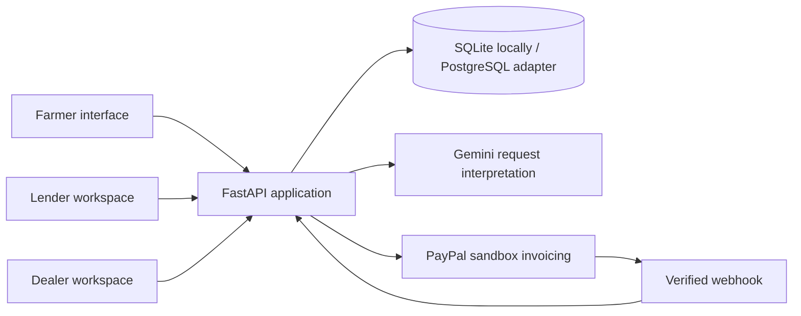

# Architecture and transaction integrity

The independent codebase shares no runtime or credentials with the previous
AFRACANet underwriting project.

## Workflow

REQUESTED → APPROVED → INVOICING → AWAITING_PAYMENT →
READY_FOR_COLLECTION → COLLECTED.

Before invoicing, REQUESTED or APPROVED may transition to CANCELLED.
An uncertain remote invoice outcome transitions to PAYMENT_REVIEW. A crash
mid-invoicing can leave INVOICING; an operator must inspect provider records.
There is deliberately no automatic repeat of uncertain invoice creation.

## Data rules

- Monetary values use integer cents; external values use Decimal parsing.
- Credit availability = approved limit − reserved − supplier-paid amount.
- Conditional updates reserve credit and inventory in one transaction.
- A database constraint forbids negative balances or reservations above the limit.
- Order creation has a unique (farmer, client request ID) key.
- Financial transitions use conditional status updates.
- Payment and collection remain separate business events.
- Catalogue prices are snapshotted in the order.
- Foreign keys and indexes cover order and audit relationships.
- Provider network calls occur outside database transactions.

## Payment confirmation

Only sandbox API hosts are used. Credentials belong to the illustrative dealer's
business account. The lender completes the invoice payment in a sandbox buyer
account; the application does not debit the lender autonomously.

Verification requires the matching invoice ID, PAID status, expected amount and
currency, and full PayPal payment transaction records. External/manual records,
partial amounts, and pending states cannot unlock collection.

Webhook messages are checked through PayPal's signature verification endpoint.
Event IDs are deduplicated transactionally. Provider detail retrieval is repeated
to verify current invoice payment facts. The authenticated Check payment status
action provides a reconciliation path when notifications are delayed.

## Access model

The current prototype uses a shared demo access code and selectable seeded
personas. Session tokens are random, stored hashed server-side, and expire in
eight hours. Server checks enforce role and subject scope. This is demonstration
access, not identity proof or production authentication.

Collection codes appear only in the farmer's order response. Dealers must obtain
the code from the farmer. Code verification records handover; it does not
independently prove delivery quality or prevent collusion.

## Limitations and next gates

- PostgreSQL connection support exists but is not yet integration-tested.
- No live SMS/USSD gateway, lender import, or editable dealer catalogue yet.
- One illustrative lender/dealer; no merchant onboarding for multiple suppliers.
- No automated reservation expiry, refund processing, or post-invoice cancellation.
- Synchronous provider requests; durable background processing remains future work.
- No production identity, rate limits, or independent audit-log immutability.
- Sandbox and Gemini adapters require live credential-based verification.
- Local SQLite data is ignored by Git. Backups and schema migrations are future work.

## Primary references

- https://developer.paypal.com/api/invoicing/v2
- https://developer.paypal.com/api/webhooks/overview/
- https://github.com/paypal/paypal-rest-api-specifications/blob/main/openapi/invoicing_v2.json
- https://ai.google.dev/gemini-api/docs/generate-content/structured-output
