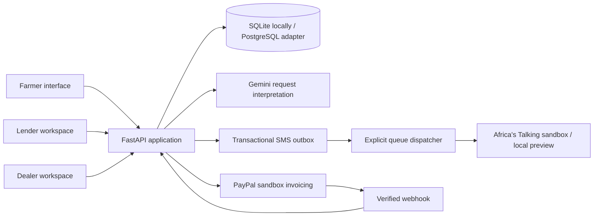

# Architecture and transaction integrity

This is the input-finance module of AFRACANet AI. Its companion credit-intelligence
module lives in afracanet-green-path. The services currently share no runtime or
credentials. A lender-authorized approval is the handoff boundary; CSV import
already supports a manual transfer. Automatic cross-service transfer remains to
be implemented. See [the unified platform brief](PLATFORM.md).

## Workflow

REQUESTED → APPROVED → INVOICING → AWAITING_PAYMENT →
READY_FOR_COLLECTION → COLLECTED.

Before invoicing, REQUESTED or APPROVED may transition to CANCELLED.
An uncertain remote invoice outcome transitions to PAYMENT_REVIEW. A crash
mid-invoicing can leave INVOICING; an operator must inspect provider records.
There is deliberately no automatic repeat of uncertain invoice creation.
The dealer can recover an existing invoice after verifying provider correlation:
order number, reference, supplier, lender, amount, and currency. Interrupted
INVOICING requests require a two-minute wait. A draft remains held for sending
from PayPal's dashboard; verified unpaid cancellation releases reservations once.
Paid or partially paid refunds are never treated as a simple credit release.

## Data rules

- Monetary values use integer cents; external values use Decimal parsing.
- Credit availability = approved limit − reserved − supplier-paid amount.
- Conditional updates reserve credit and inventory in one transaction.
- A database constraint forbids negative balances or reservations above the limit.
- Order creation has a unique (farmer, client request ID) key.
- Financial transitions use conditional status updates.
- Payment and collection remain separate business events.
- Catalogue prices are snapshotted in the order.
- Foreign keys and indexes cover order and audit relationships.
- Provider network calls occur outside database transactions.
- Approval imports validate a batch before applying it atomically; existing
  reserved/spent amounts are retained and constrain any new total limit.
- Catalogue edits compare a revision derived from the current product record.
  Concurrent changes invalidate stale forms; existing orders retain their quote.
- Issue reports have unique (order, request ID) keys. Open issues pause forward
  actions; incoming verified payments are still recorded. Only the lender can
  resolve issues. Resolution never changes financial or collection status itself.
- Issue reporting, resolution, and collection acquire the order row through a
  transactional update so their decisions serialize on SQLite and PostgreSQL.
- A late invoice-send error cannot overwrite an already confirmed payment.

## Payment confirmation

Only sandbox API hosts are used. Credentials belong to the illustrative dealer's
business account. The lender completes the invoice payment in a sandbox buyer
account; the application does not debit the lender autonomously.

Verification requires the matching invoice ID, PAID status, expected amount and
currency, and full PayPal payment transaction records. External/manual records,
partial amounts, and pending states cannot unlock collection.

Webhook messages are checked through PayPal's signature verification endpoint.
Event IDs are deduplicated transactionally. Provider detail retrieval is repeated
to verify current invoice payment facts. The authenticated Check payment status
action provides a reconciliation path when notifications are delayed.

## Access model

The current prototype uses a shared demo access code and selectable seeded or
imported farmer personas. Imported names are listed only after demo login;
the public choices endpoint lists seeded examples. Session tokens are random,
stored hashed server-side, and expire in
eight hours. Server checks enforce role and subject scope. This is demonstration
access, not identity proof or production authentication.

Collection codes appear only in the farmer's order response and are hidden while
an issue is open. Dealers must obtain
the code from the farmer. Code verification records handover; it does not
independently prove delivery quality or prevent collusion.

## SMS boundaries

Farmer contacts require opt-in and a six-digit number-verification challenge.
Only the farmer role can manage its own contact or preview its own queue. Attempts
and expiry are enforced server-side. Local verification previews are labelled;
sandbox codes must be read in the provider simulator. No real handset API host
is supported. Phone numbers and codes are not included in management audit details
or assistant prompts.

Order audit events enqueue messages in the same transaction. The worker claims
each queued row once, rechecks contact consent/current order facts, and makes
provider requests outside database transactions. Stale updates are suppressed.
Incoming financial events do not depend on SMS success. Open issues suppress
collection codes at dispatch; an already sent code cannot be recalled, so the
collection endpoint always enforces the issue hold again.

Acceptance, local preview, rejection, and uncertain outcomes are separate states.
There is no automatic retry of uncertain or interrupted sends. A scheduled worker,
delivery receipts, and production messaging remain future work.

## Limitations and next gates

- PostgreSQL has an isolated CI test job; successful execution must be confirmed
  from the run before claiming verification. Hosted operations remain unvalidated.
- This module's SMS adapter supports local previews and provider sandbox only;
  real handset delivery and SMS ordering remain outstanding. The AI module has
  an application USSD flow, which is not yet connected to payment/collection status.
- One illustrative lender/dealer; no merchant onboarding for multiple suppliers.
- No automated reservation expiry or refund processing. Post-invoice cancellation
  is verified from PayPal records; ambiguous or partially paid states stay held.
- Synchronous provider requests; durable background processing remains future work.
- No production identity, rate limits, or independent audit-log immutability.
- Sandbox and Gemini adapters require live credential-based verification.
- Local SQLite data is ignored by Git. Backups and schema migrations are future work.

## Primary references

- https://developer.paypal.com/api/invoicing/v2
- https://developer.paypal.com/api/webhooks/overview/
- https://github.com/paypal/paypal-rest-api-specifications/blob/main/openapi/invoicing_v2.json
- https://ai.google.dev/gemini-api/docs/generate-content/structured-output
